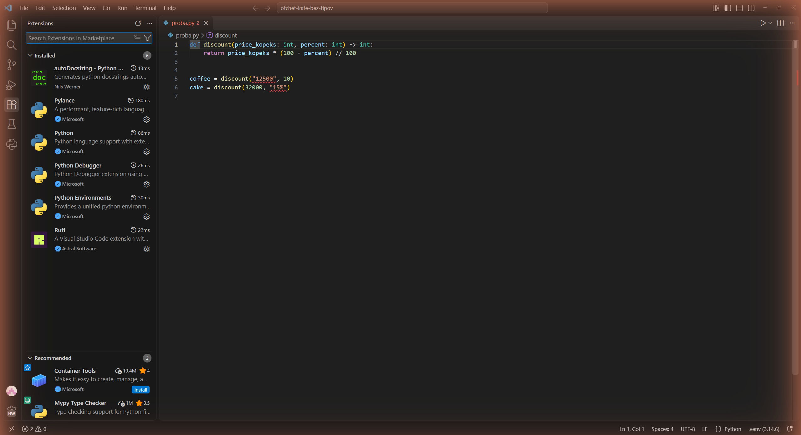
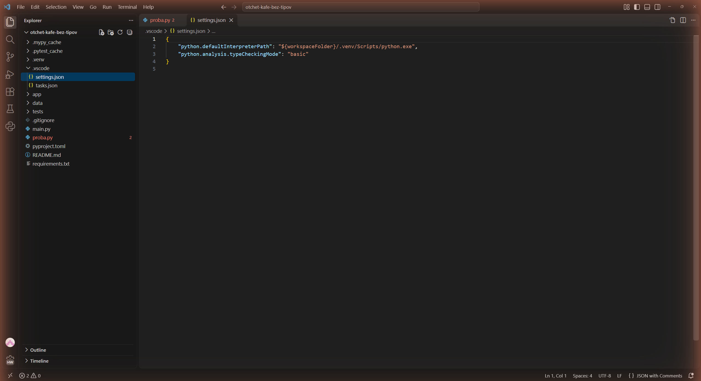
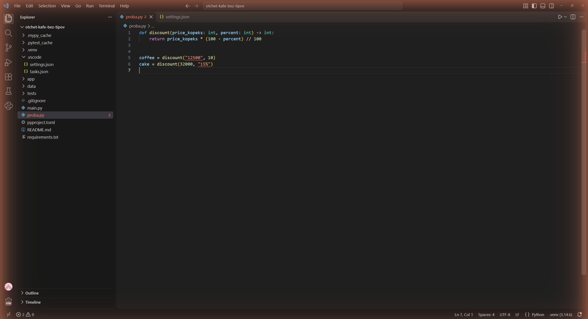
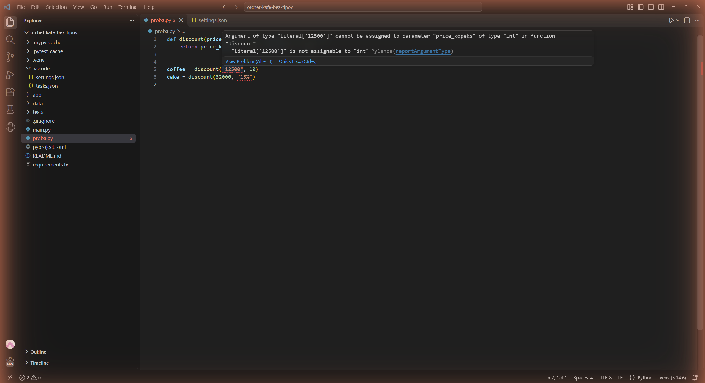
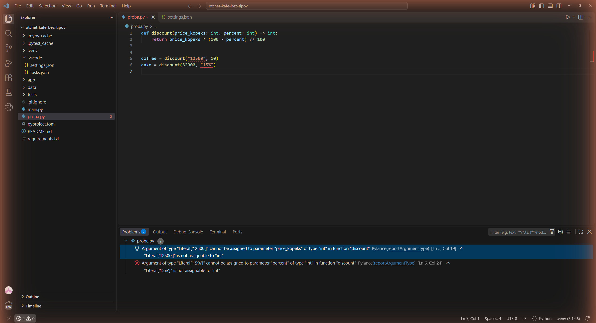
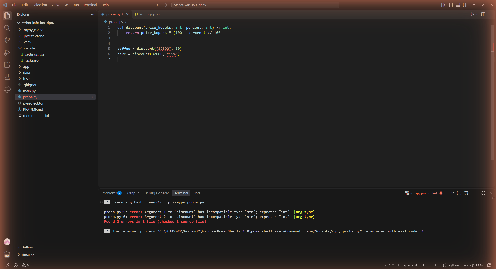
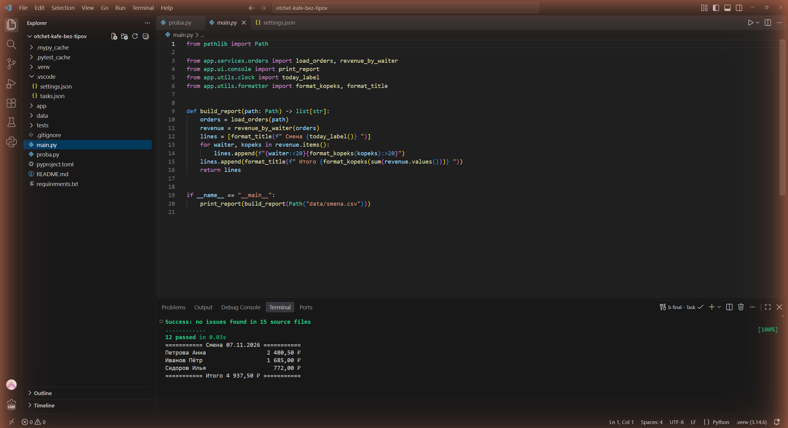

# Отчёт · Проверка типов: Pylance и mypy

**Студент:** Сдобников Андрей Андреевич, группа РПО 2/2025

Вариант — Python. Проект `lesson_05/otchet-kafe-bez-tipov`, VS Code 1.145,
Python 3.14.6 в окружении `.venv`, mypy 1.15.0.

## 1. Подготовка



*На снимке: боковая панель Extensions, раздел Installed. Стоят Python и
Pylance от Microsoft — они дают проверку типов в редакторе. В списке видны
и расширения следующего занятия (autoDocstring, Ruff).*



*На снимке: файл `.vscode/settings.json` проекта. В нём путь к интерпретатору
из `.venv` и режим проверки `"python.analysis.typeCheckingMode": "basic"`.
В дереве слева видно, что файл лежит в папке `.vscode` внутри проекта.
Интерпретатор `.venv (3.14.6)` виден в строке состояния на снимках 3–7.*

## 2. Проверка в редакторе

Для опыта написал свою функцию со скидкой и два вызова с аргументами не того
типа: цена передана строкой, процент — строкой с `%`.

```python
def discount(price_kopeks: int, percent: int) -> int:
    return price_kopeks * (100 - percent) // 100


coffee = discount("12500", 10)
cake = discount(32000, "15%")
```



*На снимке: `proba.py` открыт в редакторе. Красной волной подчёркнуты
`"12500"` в строке 5 и `"15%"` в строке 6, на вкладке файла цифра 2 —
две ошибки. Внизу справа интерпретатор `.venv (3.14.6)`.*



*На снимке: указатель наведён на `"12500"`, Pylance показывает всплывающее
сообщение об ошибке типа аргумента.*

Разбор сообщения:

| Часть сообщения | Что означает |
|---|---|
| `Argument of type "Literal['12500']"` | передано значение-литерал, строка `'12500'`; Pylance знает не только тип `str`, но и само значение |
| `cannot be assigned to parameter "price_kopeks" of type "int" in function "discount"` | параметр `price_kopeks` функции `discount` по подписи ждёт целое число |
| `"Literal['12500']" is not assignable to "int"` · `Pylance(reportArgumentType)` | короткая причина: строку нельзя подставить вместо `int`; правило, по которому выдана ошибка, — `reportArgumentType` |



*На снимке: открыта панель Problems. У `proba.py` две ошибки
`reportArgumentType`: `[Ln 5, Col 19]` про `price_kopeks` и `[Ln 6, Col 24]`
про `percent`.*

## 3. Проверка в терминале

```text
proba.py:5: error: Argument 1 to "discount" has incompatible type "str"; expected "int"  [arg-type]
proba.py:6: error: Argument 2 to "discount" has incompatible type "str"; expected "int"  [arg-type]
Found 2 errors in 1 file (checked 1 source file)
```



*На снимке: во встроенном терминале VS Code выполнена команда
`.venv/Scripts/mypy proba.py`. mypy нашёл те же две ошибки, что и Pylance,
код ошибки `[arg-type]`, итог `Found 2 errors in 1 file`.*

После исправления (`discount(12500, 10)` и `discount(32000, 15)`):

```text
Success: no issues found in 1 source file
```

## 4. Проект без аннотаций

Аннотации расставлял по слоям в порядке из главы 4.5, после каждого слоя
запускал `mypy app`:

| Этап | Итог `mypy app` |
|---|---|
| исходно | `Found 17 errors in 10 files (checked 15 source files)` |
| после `utils` | `Found 12 errors in 7 files (checked 15 source files)` |
| после `domain` | `Found 8 errors in 5 files (checked 15 source files)` |
| после `services` | `Found 1 error in 1 file (checked 15 source files)` |
| после `ui` | `Success: no issues found in 15 source files` |

Модуль до и после — `app/services/orders.py`:

```python
def load_orders(path):
def revenue_by_waiter(orders, top=0):
    totals = {}
def sort_orders_in_place(orders):
```

```python
def load_orders(path: Path) -> list[Order]:
def revenue_by_waiter(orders: list[Order], top: int = 0) -> dict[str, int]:
    totals: dict[str, int] = {}
def sort_orders_in_place(orders: list[Order]) -> None:
```

```text
> mypy app
Success: no issues found in 15 source files
> python -m pytest -q
............                                                             [100%]
12 passed in 0.04s
> python main.py
=========== Смена 07.11.2026 ===========
Петрова Анна                  2 480,50 ₽
Иванов Пётр                   1 685,00 ₽
Сидоров Илья                    772,00 ₽
=========== Итого 4 937,50 ₽ ===========
```



*На снимке: в редакторе `main.py`, в терминале одна задача выполнила три
команды подряд: `mypy app` — `Success: no issues found in 15 source files`,
`pytest -q` — `12 passed`, `python main.py` — отчёт смены с итогом
`4 937,50 ₽`.*

## 5. Выводы

Pylance и mypy находят одно и то же — вызов функции с аргументом не того типа,
но Pylance показывает это сразу при наборе, а mypy — по команде, и его удобно
запускать перед коммитом. Неожиданным оказалось, что в проекте без аннотаций
ни Pylance, ни mypy ошибок типов не видят вообще: пока у функции нет подписи,
проверять нечего, поэтому `disallow_untyped_defs` считает саму пропущенную
аннотацию ошибкой. Проверка типов не находит логических ошибок: если в
`revenue_by_waiter` перепутать сортировку по возрастанию и убыванию, типы
останутся верными, а отчёт — неправильным. Это ловят только тесты.
