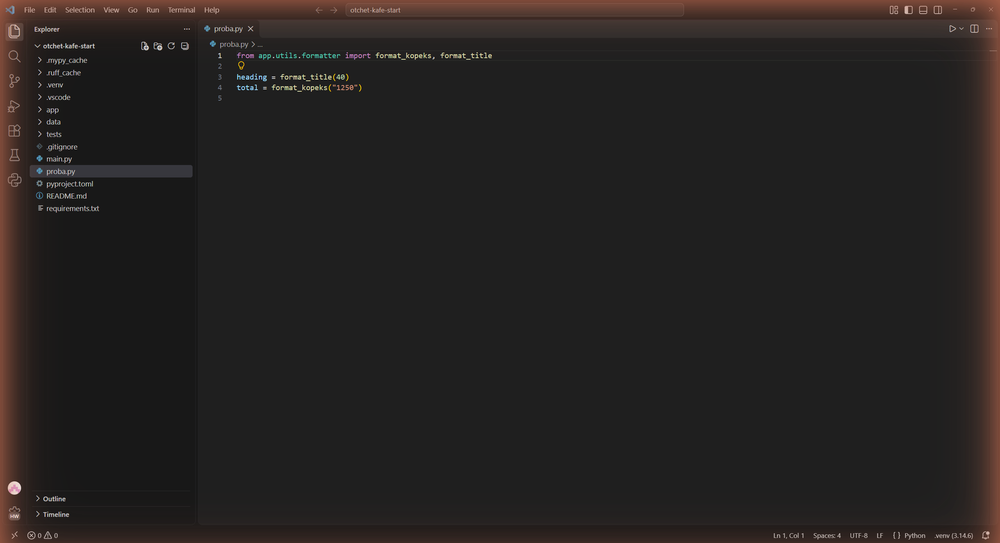
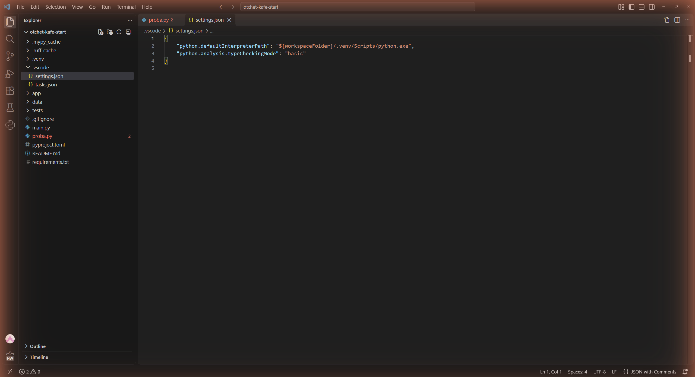
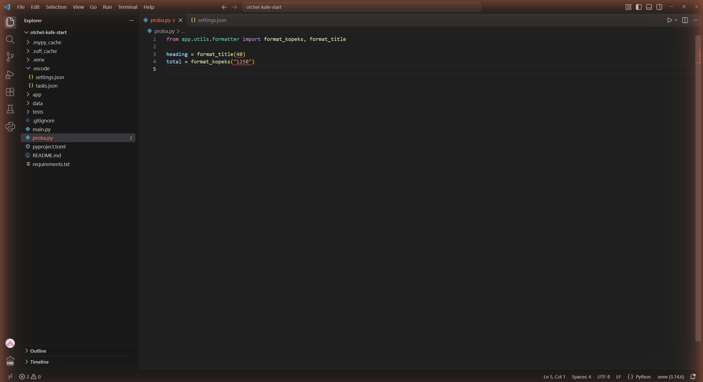
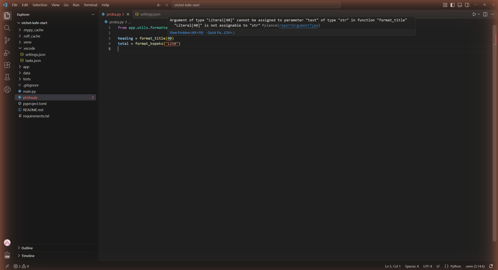
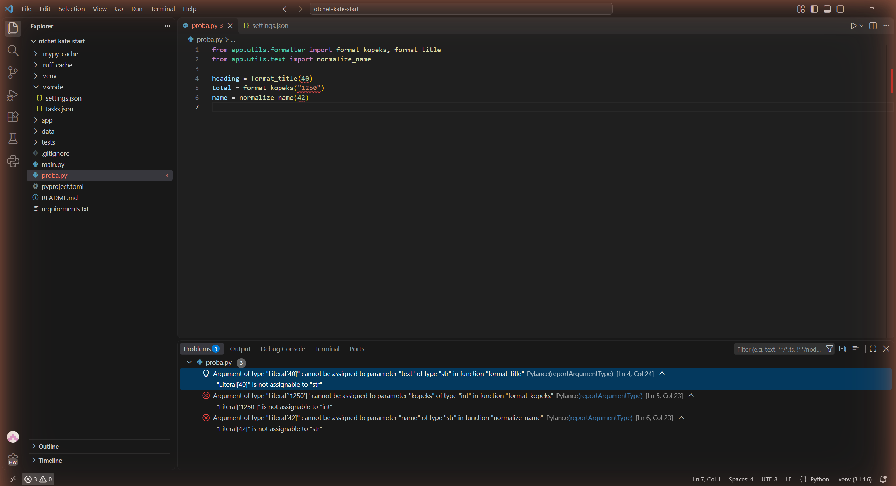
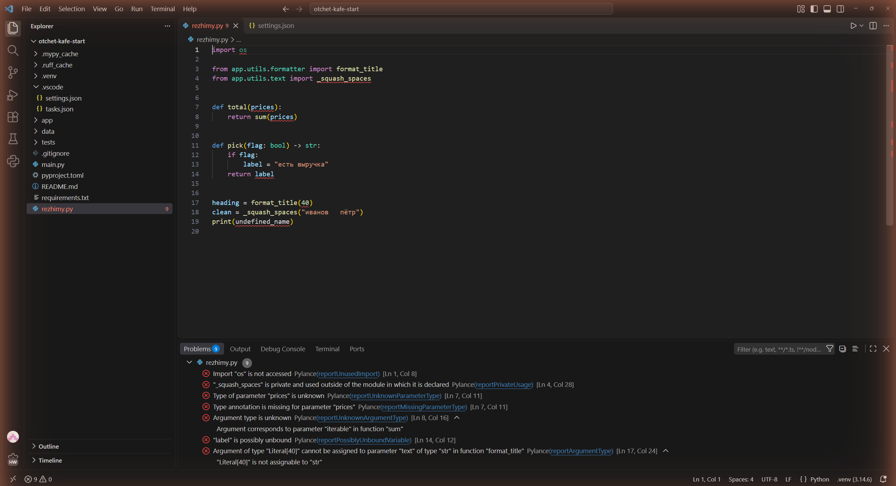
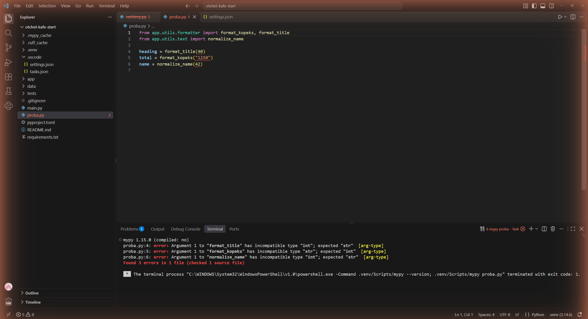
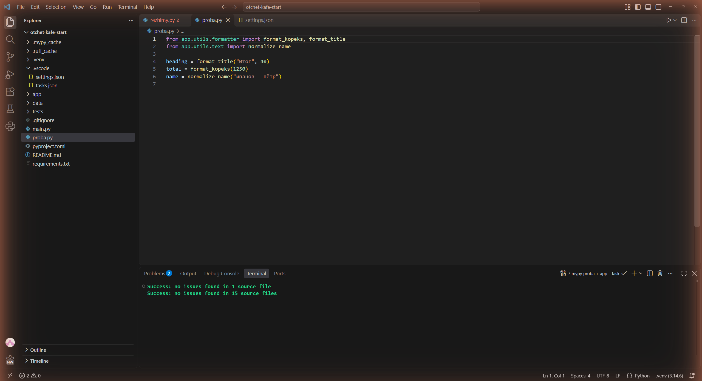
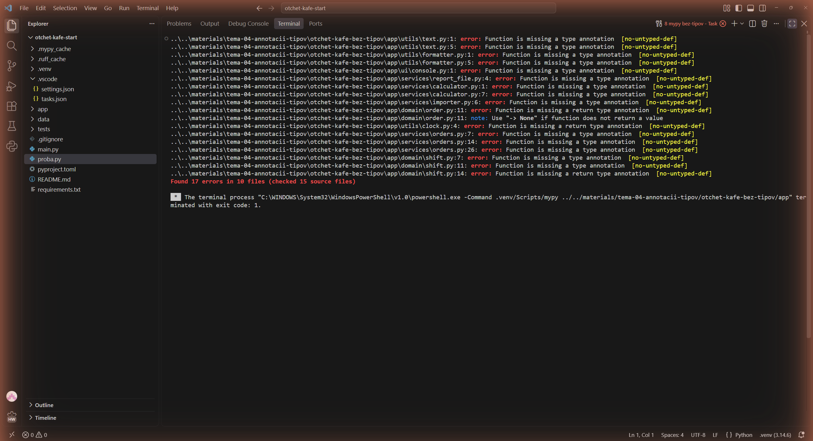
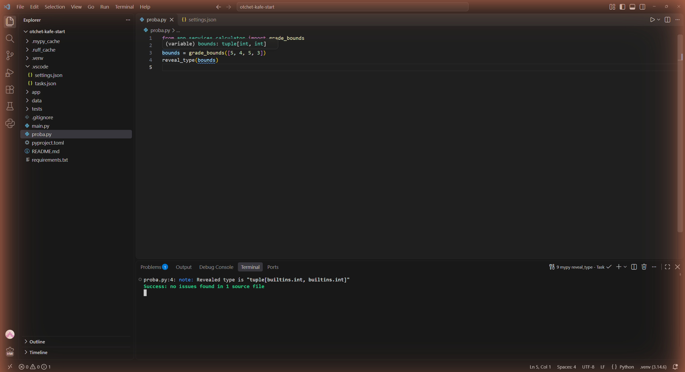

# Отчёт · Проверка типов: Pylance и mypy

**Студент:** Сдобников Андрей Андреевич, группа РПО 2/2025
**Номер в журнале:** 19, вариант шага 4: 1

Работа выполнена на втором архиве проекта «Отчёт кафе»
(`lesson_06/otchet-kafe-start`), глава 4.3.

## 1. Редактор до настройки

В корне проекта создан файл `proba.py` с двумя неверными вызовами:
`format_title(40)` и `format_kopeks("1250")`. Выбран интерпретатор
из окружения проекта, внизу справа окна написано `.venv (3.14.6)`.

*На снимке: открыт `proba.py` с двумя неверными вызовами, настройки проекта
ещё нет — Pylance работает в режиме `off`. Ни один аргумент не подчёркнут,
в строке состояния `0 ошибок`, внизу справа интерпретатор `.venv (3.14.6)`.*

В режиме `off` в файле подчёркнуто 0 аргументов. Ошибки типов в этом
режиме не показываются, аннотации идут только в подсказки.

## 2. Включение режима basic

Настройка `python.analysis.typeCheckingMode` выбрана на вкладке Workspace,
поэтому VS Code записал её в файл `.vscode/settings.json` внутри проекта.

*На снимке: файл `.vscode/settings.json` проекта, последняя строка —
`"python.analysis.typeCheckingMode": "basic"`. На вкладке `proba.py` уже
появилась цифра 2: режим сразу включил проверку.*

## 3. Ошибки в редакторе

После смены режима в `proba.py` подчёркнуты `40` и `"1250"`. На вкладке
после имени файла стоит цифра 2.

*На снимке: в `proba.py` красной волной подчёркнуты аргументы `40` и
`"1250"`, на вкладке и у файла в дереве цифра 2, в строке состояния
2 ошибки.*

Сообщение над `40`:

*На снимке: указатель наведён на `40`, всплывающее сообщение Pylance:
`Argument of type "Literal[40]" cannot be assigned to parameter "text"
of type "str" in function "format_title"`, правило `reportArgumentType`.*

Pylance называет тип переданного значения `Literal[40]`. Параметр `text`
функции `format_title` ожидает тип `str`. Правило, по которому
выдано сообщение, называется `reportArgumentType`.

## 4. Моя ошибка и панель Problems

Мой вариант — 1. В `proba.py` добавлен вызов `name = normalize_name(42)`, он стоит
в строке 6. Функция объявлена в модуле `app/utils/text.py`, её подпись:
`def normalize_name(name: str) -> str:`.

*На снимке: в `proba.py` вторая строка — импорт `normalize_name`, последняя —
мой вызов `normalize_name(42)`. Внизу открыта панель Problems: у `proba.py`
три ошибки `reportArgumentType`, третья — моя, в `[Ln 6, Col 23]`.*

В панели Problems у `proba.py` 3 ошибки. Моя ошибка стоит
на месте `[Ln 6, Col 23]`, её короткая причина в конце сообщения:
`"Literal[42]" is not assignable to "str"`.

## 5. Четыре режима на одном файле

Файл `rezhimy.py` проверен во всех четырёх режимах.
Число сообщений в панели Problems:

| Режим | Сообщений |
|---|---|
| `off` | 1 |
| `basic` | 2 |
| `standard` | 3 |
| `strict` | 9 |

*На снимке: `rezhimy.py` в режиме `strict`, панель Problems — 9 сообщений:
неиспользуемый импорт `os`, импорт приватной `_squash_spaces`, параметр
`prices` без аннотации и неизвестного типа, `label is possibly unbound`,
`format_title(40)` и неопределённое имя `undefined_name`.*

Только в `standard` и `strict` появилось сообщение про переменную
`label`: `"label" is possibly unbound`. После опыта возвращён режим `basic`.

## 6. Ошибки в терминале

Версия mypy: `mypy 1.15.0 (compiled: no)`. Команда `mypy proba.py` закончилась строкой
`Found 3 errors in 1 file (checked 1 source file)`.

*На снимке: во встроенном терминале выполнены `mypy --version` и
`mypy proba.py`. Видны версия `mypy 1.15.0`, три строки `error` с кодом
`[arg-type]` и итог `Found 3 errors in 1 file`.*

Строка с моей ошибкой: `proba.py:6: error: Argument 1 to "normalize_name" has incompatible type "int"; expected "str"  [arg-type]`.
В сообщении mypy параметр назван `Argument 1`, а Pylance называл его `name`.

## 7. Исправление

Исправленные вызовы:

| Было | Стало |
|---|---|
| `format_title(40)` | `format_title("Итог", 40)` |
| `format_kopeks("1250")` | `format_kopeks(1250)` |
| `normalize_name(42)` | `normalize_name("иванов   пётр")` |

После сохранения файла проверка повторена.

*На снимке: исправленный `proba.py` без подчёркиваний, в терминале две
строки `Success`: для `proba.py` и для пакета `app`.*

`mypy proba.py`: `Success: no issues found in 1 source file`.
`mypy app`: `Success: no issues found in 15 source files`.

## 8. Проект без аннотаций

На первом архиве mypy вывел `Found 17 errors in 10 files`.
У всех ошибок код `no-untyped-def`. Ошибки появились потому, что в `pyproject.toml`
включён параметр `disallow_untyped_defs = true`.

*На снимке: панель терминала развёрнута на всё окно, mypy проверил
`materials/.../otchet-kafe-bez-tipov/app`. Список из 17 ошибок
`Function is missing a type annotation [no-untyped-def]` и итог
`Found 17 errors in 10 files (checked 15 source files)`.*

Первая строка списка: `..\..\materials\tema-04-annotacii-tipov\otchet-kafe-bez-tipov\app\utils\text.py:1: error: Function is missing a type annotation  [no-untyped-def]`.

## 9. Какой тип видит проверка

*На снимке: в `proba.py` вызов `grade_bounds([5, 4, 5, 3])` и строка
`reveal_type(bounds)`. Указатель наведён на `bounds` — подсказка Pylance
`(variable) bounds: tuple[int, int]`; в терминале mypy вывел
`Revealed type is "tuple[builtins.int, builtins.int]"`.*

Pylance при наведении на `bounds` показал `tuple[int, int]`. mypy в строке
`reveal_type` вывел `Revealed type is "tuple[builtins.int, builtins.int]"`.

## 10. Итог

Если Pylance ошибок не показывает, а mypy показывает, первым делом
проверяю, какой режим `typeCheckingMode` выбран и какой интерпретатор стоит
внизу справа: в режиме `off` или с чужим Python Pylance молчит.

Не получилось: всё получилось. Python 3.12 у меня не стоит, работа сделана
на Python 3.14.6 — mypy и Pylance работают так же.

ИИ: использовался (Claude Code) при выполнении шагов и оформлении отчёта.
