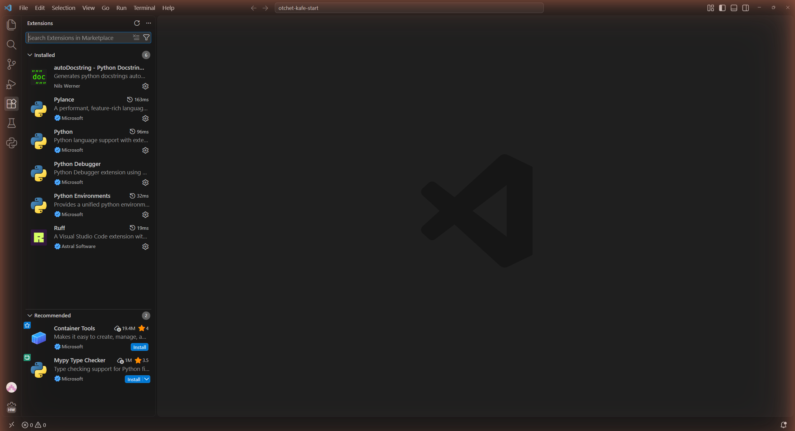
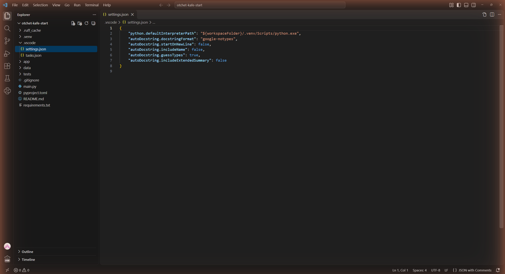
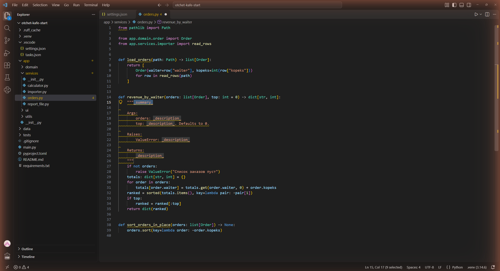
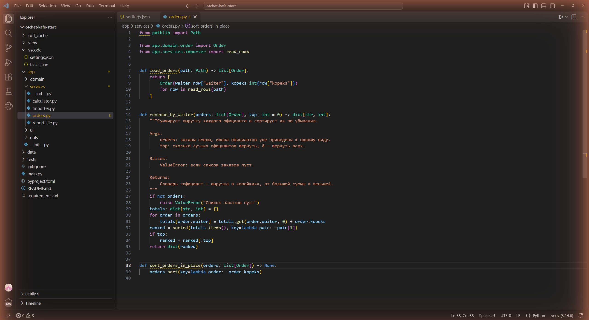
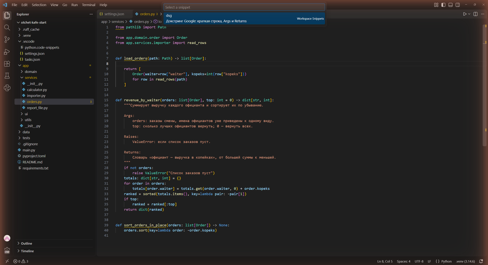
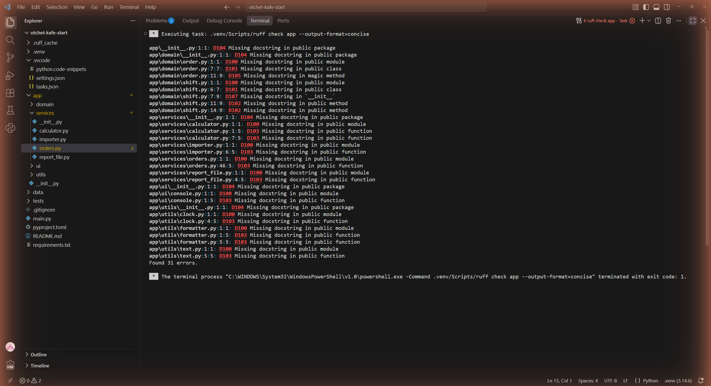
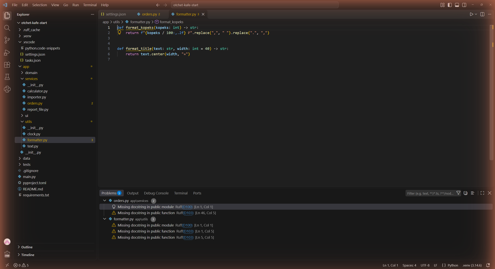
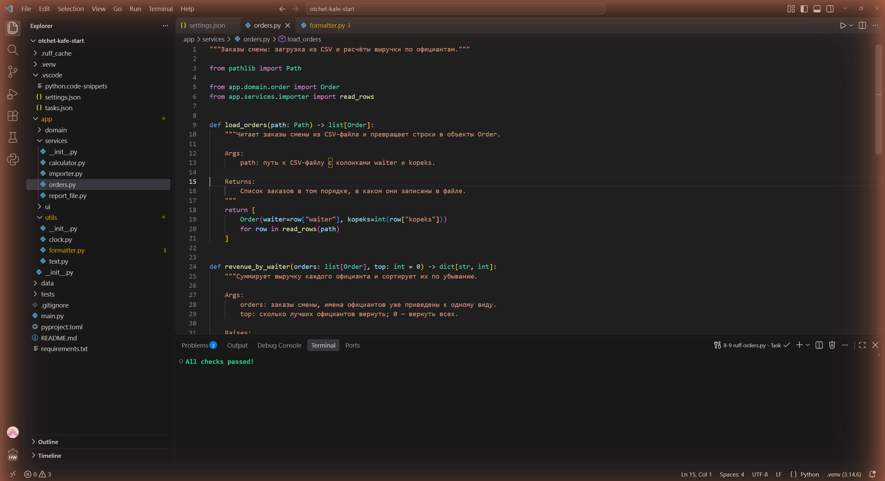
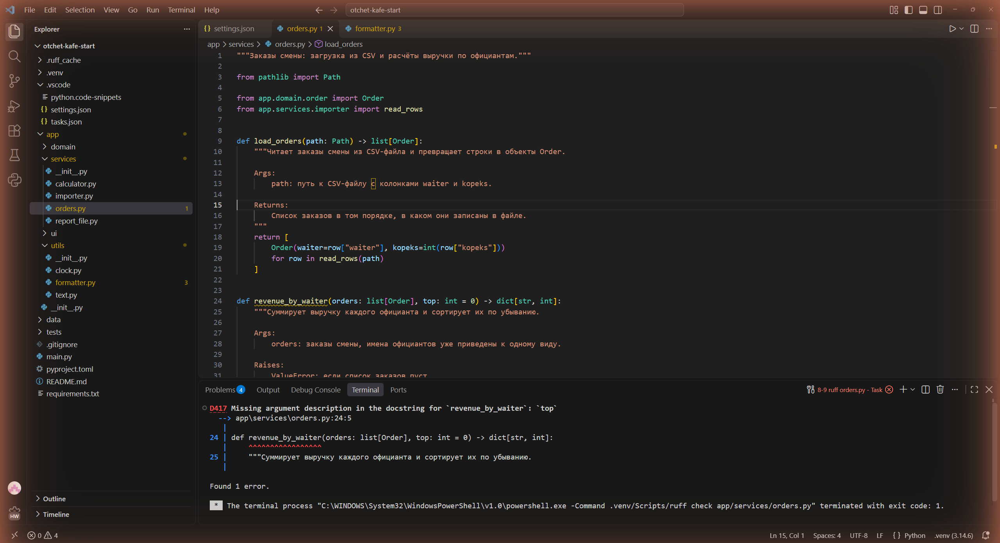
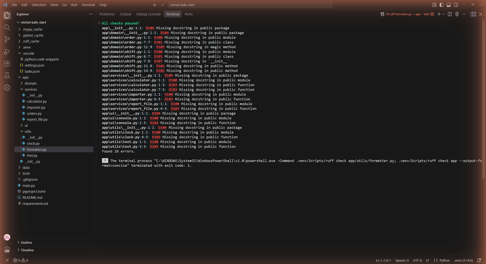

# Отчёт · Докстринги в VS Code: генератор и проверка

**Студент:** Сдобников Андрей Андреевич, группа РПО 2/2025
**Номер в журнале:** 19, вариант шагов 7 и 10: 1, модуль `app/utils/formatter.py`

Работа выполнена на втором архиве проекта «Отчёт кафе»
(`lesson_07/otchet-kafe-start`), глава 4.10.

## 1. Расширения

Установлены расширения `njpwerner.autodocstring` и `charliermarsh.ruff`.
Автор autoDocstring на карточке расширения: Nils Werner. Издатель Ruff: Astral Software.



*На снимке: боковая панель Extensions, раздел Installed. В списке
autoDocstring (Nils Werner), Pylance и Python (Microsoft) и Ruff
(Astral Software).*

## 2. Настройки проекта

Настройки генератора записаны в файл `.vscode/settings.json`. Он лежит внутри проекта
и попадает в репозиторий, поэтому заготовка у всех, кто откроет проект,
будет одинаковой.



*На снимке: `.vscode/settings.json` проекта: интерпретатор из `.venv`,
формат `"autoDocstring.docstringFormat": "google-notypes"` и четыре настройки
вида заготовки — `startOnNewLine: false`, `includeName: false`,
`guessTypes: true`, `includeExtendedSummary: false`.*

Формат заготовки — `google-notypes`. С проверкой Ruff он согласуется, потому что
в `pyproject.toml` записано `convention = "google"`. Настройка
`startOnNewLine` оставлена `false`: иначе Ruff выдаст замечание `D212`.

## 3. Заготовка генератора

Генератор вызван у функции `revenue_by_waiter` способом: курсор на пустой
строке под подписью, затем команда **Generate Docstring** из палитры команд
(**View → Command Palette**).



*На снимке: в `app/services/orders.py` под подписью `revenue_by_waiter`
появилась заготовка autoDocstring: `_summary_`, разделы `Args:` (orders, top
с подсказкой `Defaults to 0.`), `Raises:` (ValueError) и `Returns:`. Поля
`_summary_` и `_description_` выделены как места для заполнения, типов в
скобках нет.*

В заготовке разделы `Args:`, `Raises:` и `Returns:`. Раздел `Raises:` появился,
потому что в теле функции есть `raise ValueError`. Типов в скобках нет, потому что
выбран формат google-notypes.

## 4. Заполненный докстринг



*На снимке: тот же докстринг после заполнения — ни `_summary_`, ни
`_description_` не осталось, у каждого параметра и у исключения своё описание.*

Краткая строка: «Суммирует выручку каждого официанта и сортирует их по убыванию.».
Параметр `top` описан так: «сколько лучших официантов вернуть; 0 — вернуть всех.».

## 5. Сниппет

Сниппет записан в файл `.vscode/python.code-snippets`. Его название — «Google-докстринг функции», слово для вызова —
`dsg`. Им вставлен докстринг функции `load_orders`.



*На снимке: курсор на пустой строке под `load_orders`, открыт список
сниппетов (**Snippets: Insert Snippet**): строка `dsg` с описанием
«Докстринг Google: краткая строка, Args и Returns» и пометкой Workspace
Snippets — сниппет взят из файла проекта.*

Имя параметра `path` в сниппет вписано вручную: сниппет вставляет один и тот же
текст для любой функции и подпись не читает.

## 6. Проверка всего пакета

Команда `ruff check app --output-format=concise` закончилась строкой
`Found 31 errors.`



*На снимке: панель терминала развёрнута, выполнена
`ruff check app --output-format=concise`: по строке на каждое замечание
(D100, D103, D104, D101, D102, D105, D107) и итог `Found 31 errors.`*

Чаще других в выводе два кода. `D100` означает: нет докстринга у публичного модуля.
`D103` означает: нет докстринга у публичной функции. Каждого по 10.

## 7. Замечания в редакторе

Модуль моего варианта — `app/utils/formatter.py`. В панели Problems у него 3 замечания.
Источник у каждого замечания — `Ruff`.



*На снимке: открыт `formatter.py`, в панели Problems у него три замечания с
источником `Ruff(D100)` и `Ruff(D103)` ×2 — нет докстринга модуля и двух
функций. Выше — два оставшихся замечания у `orders.py`.*

## 8. Модуль orders.py без замечаний

Докстринг модуля `orders.py`: «Заказы смены: загрузка из CSV и расчёты выручки по официантам.».
Докстринг `sort_orders_in_place`: «Упорядочивает заказы прямо в переданном списке: самые дорогие первыми.».



*На снимке: в первой строке `orders.py` докстринг модуля; задача
`8-9 ruff orders.py` выполнила `ruff check app/services/orders.py`, вывод —
`All checks passed!`.*

## 9. Опыт с D417

После удаления строки про `top` проверка вывела:
``D417 Missing argument description in the docstring for `revenue_by_waiter`: `top` ``.



*На снимке: в разделе `Args:` у `revenue_by_waiter` осталась только строка
про `orders`. В терминале Ruff показывает `D417` и указывает на строку 24 с
подписью функции, итог `Found 1 error.`*

Правило D417 сравнивает раздел `Args:` с подписью функции. Остальные правила
из вывода проверяют, есть ли докстринг и как он оформлен. После опыта
строка про `top` возвращена.

## 10. Модуль моего варианта

До работы проверка модуля `app/utils/formatter.py` выводила `Found 3 errors.`, после —
`All checks passed!`. В пакете `app` осталось `Found 26 errors.`



*На снимке: одна задача выполнила две проверки: первая строка
`All checks passed!` — для `app/utils/formatter.py`, ниже вывод по всему
пакету `app`, в нём нет ни `orders.py`, ни `formatter.py`, итог
`Found 26 errors.`*

Докстринг одной из функций модуля:

```python
def format_title(text: str, width: int = 40) -> str:
    """Ставит текст по центру строки и заполняет края знаком «=».

    Args:
        text: текст заголовка, обычно с пробелами по краям.
        width: длина итоговой строки в символах.

    Returns:
        Заголовок ровно заданной ширины, если текст не длиннее width.
    """
```

## 11. Итог

Ruff проверяет, что докстринг есть, оформлен по правилам и перечисляет
все параметры подписи. Верность описания по смыслу Ruff не проверяет:
докстринг с текстом `_description_` для него в порядке.

Не получилось: всё получилось. Тесты (`12 passed`) и `mypy app` после
добавления докстрингов тоже проходят.

ИИ: использовался (Claude Code) при выполнении шагов и оформлении отчёта.
